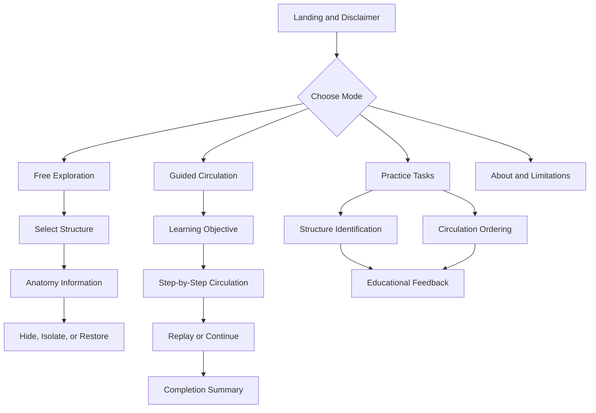
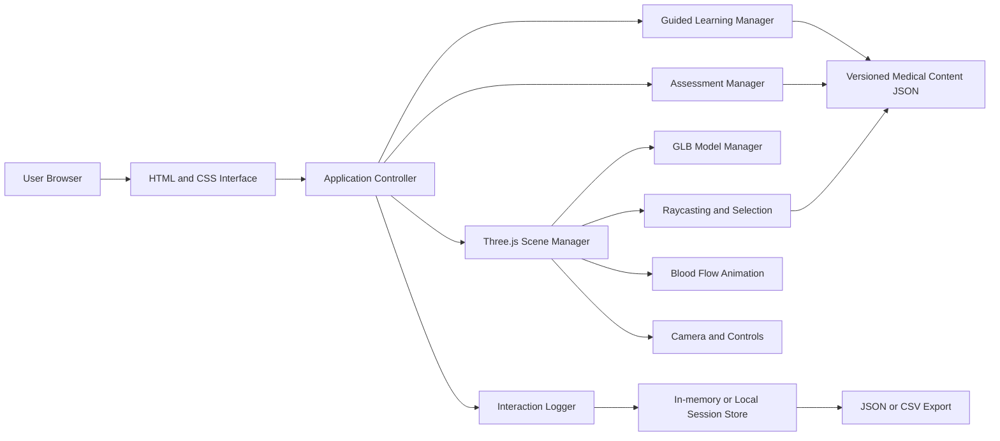
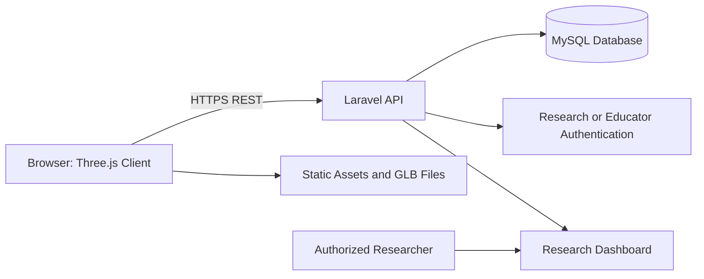
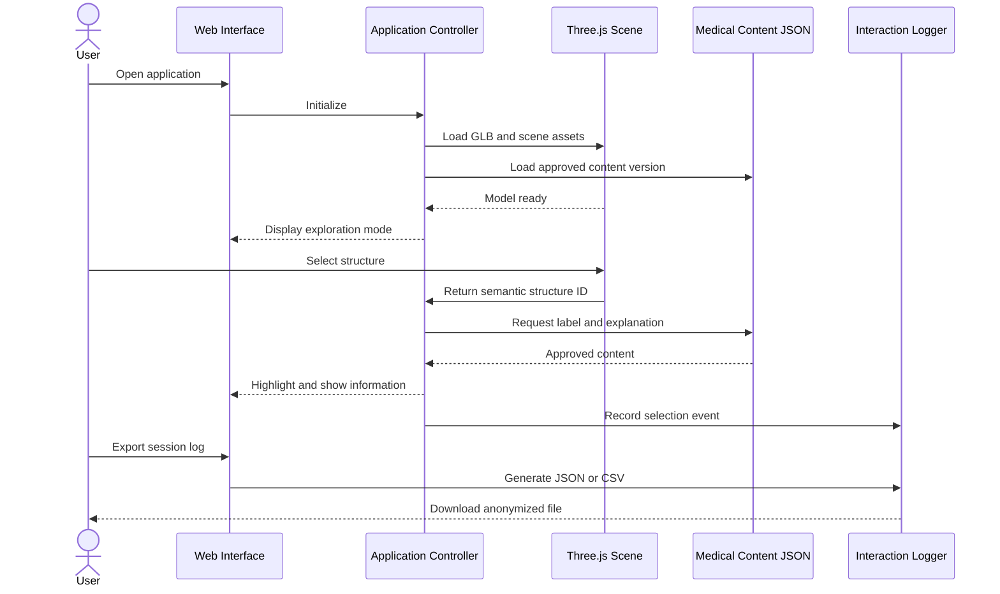
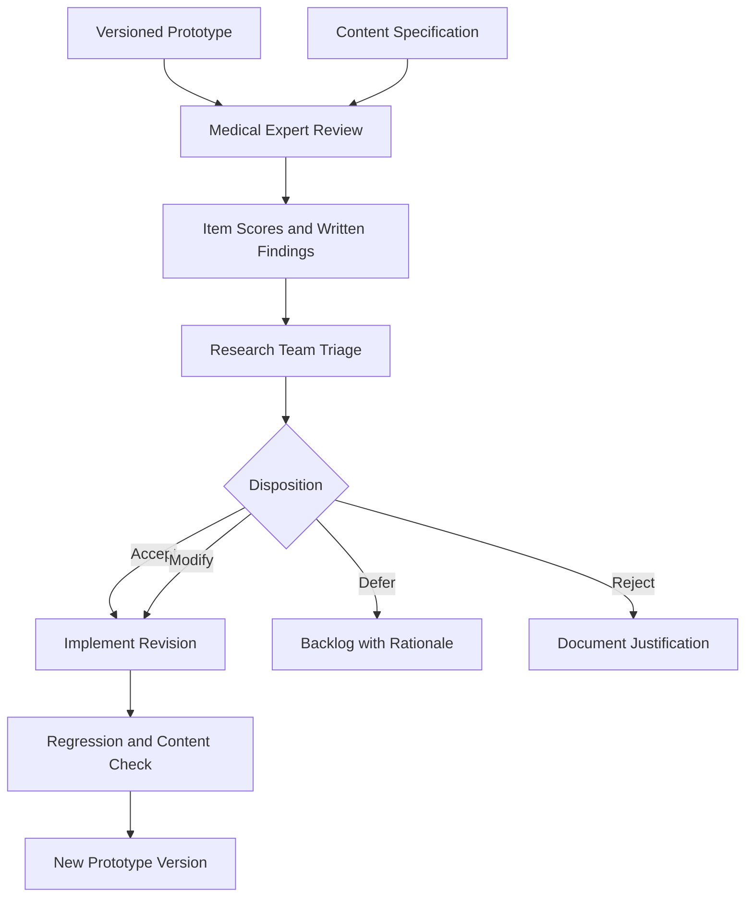
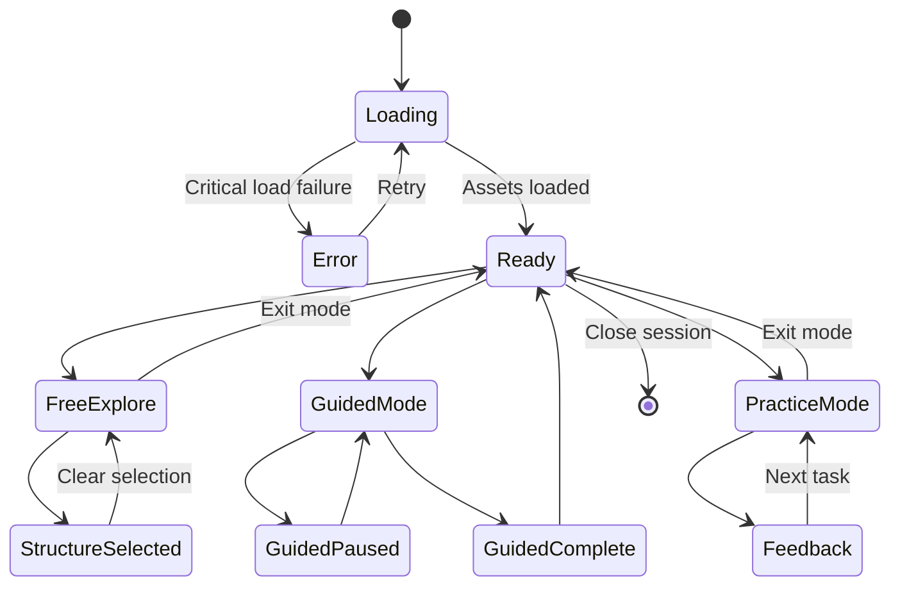

# Product Requirements Document (PRD)

## CardioExplore 3D

**Research title:** *Design and Development of a Web-Based Interactive 3D Cardiac Simulation for Immersive Health Education: A Preliminary Study*  
**Document version:** 1.0  
**Status:** Draft for preliminary research and prototype development  
**Date:** 13 November 2026  
**Product type:** Browser-based interactive 3D educational simulation  
**Primary technology:** HTML5, CSS3, JavaScript, WebGL, Three.js, Vite  
**Research approach:** Design Science Research Methodology (DSRM)

---

## 1. Executive Summary

CardioExplore 3D is a web-based interactive three-dimensional cardiac simulation intended to support foundational health education. The product will allow learners to explore major cardiac structures, observe a simplified representation of pulmonary and systemic circulation, follow guided learning activities, and complete basic structure-identification tasks directly through a modern web browser.

The preliminary study focuses on the design and development of the artifact, technical verification, cross-device performance, and medically informed content review. It does not aim to diagnose disease, provide treatment recommendations, reproduce patient-specific physiology, or establish clinical efficacy. The visualization is an educational abstraction whose anatomical terminology, circulation sequence, labels, colors, explanatory content, and potential misconceptions must be reviewed by medical-domain experts before learner testing.

The initial minimum viable product, or MVP, will be built using HTML5, CSS3, JavaScript ES Modules, WebGL, Three.js, and Vite. Three-dimensional assets will use GLB/glTF format and will be optimized for browser delivery. The application will be deployable as a static web application, while its modular architecture will permit future integration with a Laravel REST API, a research database, and WebXR capabilities.

---

## 2. Product Vision

### 2.1 Vision Statement

To provide an accessible, medically informed, browser-based 3D environment that helps learners understand the spatial relationships among major cardiac structures and the sequential flow of blood through interactive exploration.

### 2.2 Product Proposition

Unlike static diagrams, CardioExplore 3D combines:

- manipulable three-dimensional cardiac structures;
- selectable anatomical components;
- contextual labels and concise explanations;
- animated pulmonary and systemic circulation;
- guided exploration with step-by-step focus;
- lightweight task-based assessment;
- browser-based delivery without application installation;
- technical and interaction telemetry for research purposes.

### 2.3 Definition of “Immersive” in This Study

In the preliminary version, “immersive” means an interactive and visually engaging 3D learning experience that supports active spatial exploration, guided attention, visual feedback, and dynamic observation through a browser. It does not imply that the MVP requires a virtual-reality headset. WebXR and headset-based immersion are future extensions and are outside the MVP scope.

---

## 3. Background and Problem Statement

Cardiac anatomy and circulation require learners to connect spatial structures with dynamic processes. Static two-dimensional materials can show labels and flow arrows, but generally provide limited control over orientation, visibility, sequencing, and exploration. A browser-based 3D simulation can provide direct manipulation and dynamic visualization while avoiding installation barriers associated with native desktop applications.

The product addresses the following design problem:

> There is a need for an accessible web-based interactive 3D environment that integrates foundational cardiac anatomy, simplified blood-flow visualization, guided exploration, and medically reviewed educational content without presenting itself as a clinical simulation or diagnostic system.

---

## 4. Research Positioning

### 4.1 Research Title

**Design and Development of a Web-Based Interactive 3D Cardiac Simulation for Immersive Health Education: A Preliminary Study**

### 4.2 Research Objectives

1. Design a modular browser-based architecture for interactive cardiac visualization.
2. Develop a functional Three.js prototype for exploring major cardiac structures.
3. Implement an educational animation of pulmonary and systemic blood circulation.
4. Develop guided exploration and structure-identification activities.
5. Verify functional correctness and technical performance across representative devices.
6. Conduct medically informed content review covering terminology, anatomy, circulation, educational relevance, and potential misconceptions.
7. Produce a revised artifact and requirements baseline for subsequent learner-based usability research.

### 4.3 Research Questions

- **RQ1:** How can a web-based interactive 3D cardiac simulation be designed to integrate anatomical exploration, blood-flow visualization, and guided learning in a modular browser-based environment?
- **RQ2:** To what extent does the developed prototype satisfy its functional and cross-device performance requirements?
- **RQ3:** What medically relevant revisions are identified through expert review before the prototype is evaluated with learners?

### 4.4 Preliminary Study Outputs

The preliminary study is expected to produce:

- a deployable web prototype;
- a documented system architecture;
- an optimized 3D asset pipeline;
- an anatomical-content specification;
- guided-exploration scenarios;
- functional and performance test results;
- expert-review findings;
- a revision log showing changes made to the product;
- limitations and requirements for a future learner study.

---

## 5. Scope

### 5.1 MVP Scope

The MVP includes:

1. browser-based access without installation;
2. loading and rendering of an optimized 3D heart model;
3. orbit, zoom, limited pan, reset, and focus controls;
4. selection of major cardiac structures;
5. labels and concise educational descriptions;
6. show, hide, isolate, and restore functions;
7. pulmonary and systemic circulation animation;
8. play, pause, reset, speed, and step-by-step controls;
9. guided exploration with progress indication;
10. basic identification and sequence tasks;
11. anonymous local interaction logging;
12. export of research logs in JSON or CSV;
13. responsive layout for laptop, tablet, and supported smartphones;
14. functional, compatibility, and performance testing;
15. medical expert-review workflow;
16. educational and medical disclaimers.

### 5.2 Out of Scope for the Preliminary Study

The MVP will not include:

- clinical diagnosis or treatment recommendations;
- patient-specific modeling;
- electronic medical record integration;
- real-time biosignal integration;
- computational fluid dynamics;
- pressure, volume, or hemodynamic simulation;
- ECG generation based on physiological equations;
- disease-progression prediction;
- AI-based diagnosis;
- multiplayer collaboration;
- mandatory accounts or authentication;
- formal proof of learning effectiveness;
- comparison against textbooks, video, or VR;
- mandatory WebXR or headset support;
- claims of anatomical completeness or clinical fidelity.

### 5.3 Future Scope

Potential later phases include:

- WebXR and virtual-reality mode;
- learner accounts and learning analytics;
- Laravel REST API and MySQL storage;
- teacher dashboard;
- multilingual content;
- adaptive learning paths;
- assessment question banks;
- disease-specific visualizations reviewed by subject specialists;
- comparison of desktop 3D and immersive VR modes;
- pre-test/post-test studies;
- integration with learning-management systems through xAPI or LTI.

---

## 6. Stakeholders and Roles

| Stakeholder | Primary responsibility | Key deliverable |
|---|---|---|
| Principal investigator / technical lead | Research design, architecture, Three.js development, technical testing, manuscript coordination | Working prototype and technical documentation |
| Medical co-designer / co-author | Medical objectives, terminology, circulation sequence, educational content, misconception review | Medically informed content specification |
| Independent medical reviewer(s) | Independent review of anatomical and physiological representations | Completed expert-review forms and recommendations |
| HCI or educational-technology reviewer | Review interaction consistency, cognitive load risks, and task flow | Heuristic findings |
| 3D asset contributor | Model preparation, segmentation, optimization, and export | Optimized GLB assets |
| Research assistant | Testing, documentation, data cleaning, and evidence capture | Test logs and revision records |
| Future learner participant | Usability and learning evaluation in a subsequent study | Not included in the preliminary MVP evaluation |

### 6.1 Authorship and Review Independence

If a medical collaborator contributes to problem formulation, requirements, content, interpretation, and manuscript writing, the collaborator may appropriately serve as a co-author. However, a co-author’s review should be reported as an internal medically informed design review. If the paper claims independent expert review or expert validation, at least one additional reviewer who is not directly responsible for developing the artifact should be included.

---

## 7. Target Users and Personas

### 7.1 Primary Persona: Foundational Health Learner

- **Profile:** Early-stage medical, nursing, allied-health, or health-science learner.
- **Need:** Understand major chambers, vessels, and circulation sequence.
- **Challenge:** Translating flat diagrams into spatial relationships.
- **Goal:** Explore, identify, and trace structures independently.
- **Device:** Laptop or tablet using a modern browser.

### 7.2 Secondary Persona: Health Educator

- **Profile:** Lecturer or instructor explaining basic cardiac anatomy and circulation.
- **Need:** A web-delivered visual aid that can be demonstrated in class.
- **Goal:** Focus attention on selected structures and control circulation steps.
- **Device:** Laptop connected to a classroom display or projector.

### 7.3 Research Persona: Medical Expert Reviewer

- **Profile:** Lecturer or clinician with relevant anatomy, physiology, cardiovascular, pathology, or health-education expertise.
- **Need:** Inspect fidelity, terminology, explanatory text, sequencing, and potential misconceptions.
- **Goal:** Recommend major or minor revisions before learner testing.

### 7.4 Technical Researcher

- **Profile:** Informatics, HCI, visualization, or educational-technology researcher.
- **Need:** Inspect architecture, performance, interaction logs, and reproducibility.
- **Goal:** Evaluate the artifact as an interactive-computing contribution.

---

## 8. User Needs and Jobs to Be Done

| User | Job to be done | Success evidence |
|---|---|---|
| Learner | Explore the heart from multiple angles | User can rotate, zoom, reset, and focus the model |
| Learner | Identify a selected structure | Correct object highlights and displays an accurate label |
| Learner | Follow deoxygenated and oxygenated blood flow | User can observe the complete ordered circulation sequence |
| Learner | Learn without being overwhelmed | Content is progressively disclosed and avoids excessive labels |
| Educator | Demonstrate one structure or pathway | Selected components can be isolated and animated step by step |
| Medical reviewer | Detect inaccuracies or misconceptions | Review form supports item-level scores and comments |
| Researcher | Analyze technical and interaction events | Logs are exportable using anonymous session identifiers |

---

## 9. Learning Content Requirements

### 9.1 Required Structures

The MVP should support the following structures, subject to medical review:

- right atrium;
- left atrium;
- right ventricle;
- left ventricle;
- superior vena cava;
- inferior vena cava;
- pulmonary trunk or pulmonary artery representation;
- pulmonary veins;
- aorta;
- optional simplified valves if the model supports clear representation.

### 9.2 Circulation Sequence

The educational sequence shall represent:

1. systemic return through the venae cavae;
2. entry into the right atrium;
3. flow into the right ventricle;
4. exit through the pulmonary circulation pathway;
5. return from the lungs through the pulmonary veins;
6. entry into the left atrium;
7. flow into the left ventricle;
8. exit through the aorta to systemic circulation.

The MVP may represent the lungs and systemic body as abstract endpoints. It must clearly identify the visualization as simplified and must not imply computational fluid dynamics or patient-specific flow.

### 9.3 Color Semantics

- A consistent color scheme shall distinguish oxygenated and deoxygenated blood.
- The interface shall explain that blue and red are conventional educational encodings and do not represent the literal color of blood inside the body.
- Color shall not be the only cue; use directional particles, arrows, labels, patterns, or path emphasis.
- Color choices must be reviewed for common red-green color-vision deficiencies.

### 9.4 Terminology Rules

- Use standardized English anatomical terms in the research prototype.
- Optional Indonesian translations may be added through a language file.
- Avoid colloquial terms when a standard anatomical term is available.
- Every label and definition requires review by the medical co-designer.
- Explanations should be concise, introductory, and free from diagnostic advice.

---

## 10. User Journeys

### 10.1 Free Exploration Journey

1. User opens the application URL.
2. System displays loading progress and compatibility status.
3. User reads the educational disclaimer.
4. System loads the default heart orientation.
5. User rotates and zooms the model.
6. User selects a structure.
7. System highlights it and opens an information panel.
8. User isolates or hides the structure.
9. User restores the complete model.
10. System logs anonymous interaction events.

### 10.2 Guided Circulation Journey

1. User chooses **Guided Circulation**.
2. System presents the learning objective.
3. The camera moves to the first structure.
4. The active structure and pathway are highlighted.
5. Animated particles indicate direction.
6. A concise explanation appears.
7. User continues to the next step or replays the current step.
8. System displays progress through the sequence.
9. User completes a short ordering or identification task.
10. System provides corrective educational feedback.

### 10.3 Expert Review Journey

1. Reviewer receives a versioned prototype and review form.
2. Reviewer completes a conflict-of-interest and expertise description.
3. Reviewer checks structures, terminology, circulation, color, explanations, and misconceptions.
4. Reviewer rates each item using a four-point relevance and accuracy scale.
5. Reviewer classifies issues as critical, major, minor, or editorial.
6. Research team records disposition: accepted, modified, deferred, or rejected with rationale.
7. Revised prototype is assigned a new version number.

---

## 11. Functional Requirements

Priority follows the MoSCoW scheme: **Must**, **Should**, **Could**, and **Won’t for MVP**.

### 11.1 Application Shell and Loading

| ID | Requirement | Priority | Acceptance criterion |
|---|---|---|---|
| FR-001 | The application shall run in a modern browser without installation. | Must | Application launches through an HTTPS URL and reaches the main scene. |
| FR-002 | The application shall display asset-loading progress. | Must | Progress indicator updates and is hidden after initialization. |
| FR-003 | The application shall show a recoverable error when WebGL or required assets are unavailable. | Must | User sees a readable message and retry or fallback instruction. |
| FR-004 | The application shall display product version and content-review version. | Should | Version is visible in About or footer. |
| FR-005 | The application shall offer a reduced-quality mode. | Should | User can lower quality before or after scene loading. |

### 11.2 3D Navigation

| ID | Requirement | Priority | Acceptance criterion |
|---|---|---|---|
| FR-010 | User shall be able to rotate the cardiac model. | Must | Pointer drag or touch gesture rotates the view smoothly. |
| FR-011 | User shall be able to zoom within safe limits. | Must | Zoom is clamped to prevent clipping or loss of the model. |
| FR-012 | User shall be able to reset the camera. | Must | Reset returns to the documented default orientation. |
| FR-013 | User shall be able to focus on a selected structure. | Should | Camera animates to frame the selected structure. |
| FR-014 | User shall be able to use keyboard-accessible navigation controls. | Should | Focusable controls operate without a pointing device. |

### 11.3 Anatomy Interaction

| ID | Requirement | Priority | Acceptance criterion |
|---|---|---|---|
| FR-020 | Clicking or tapping a supported structure shall select it. | Must | Raycasting returns the correct semantic structure ID. |
| FR-021 | Selected structures shall be visually highlighted. | Must | Highlight is visible without permanently changing material data. |
| FR-022 | The information panel shall show name, category, and concise description. | Must | Content matches the approved anatomy-content file. |
| FR-023 | User shall be able to hide, show, and isolate supported structures. | Should | Visual state changes without reloading the scene. |
| FR-024 | User shall be able to restore all structures. | Must | One action restores the default visibility state. |
| FR-025 | Labels shall avoid excessive overlap. | Should | Labels reposition, hide, or collapse according to view rules. |

### 11.4 Circulation Animation

| ID | Requirement | Priority | Acceptance criterion |
|---|---|---|---|
| FR-030 | System shall visualize the complete simplified circulation sequence. | Must | All approved stages can be played in order. |
| FR-031 | User shall be able to play, pause, restart, and change speed. | Must | Controls change animation state consistently. |
| FR-032 | User shall be able to play the sequence step by step. | Must | Only the selected stage is emphasized and explained. |
| FR-033 | Direction shall be visible through motion and at least one additional cue. | Must | Direction remains understandable without relying solely on color. |
| FR-034 | The system shall distinguish oxygenated and deoxygenated pathways. | Must | Legend and visual encodings remain consistent across stages. |
| FR-035 | Animation speed shall be described as illustrative, not physiologically timed. | Must | Disclaimer is visible near animation controls or About content. |

### 11.5 Guided Learning

| ID | Requirement | Priority | Acceptance criterion |
|---|---|---|---|
| FR-040 | System shall provide at least one guided exploration module. | Must | Module has objective, ordered steps, and completion state. |
| FR-041 | Guided mode shall automatically focus the relevant structure. | Must | Camera and highlight correspond to the active step. |
| FR-042 | User shall be able to repeat or move backward. | Must | Previous and replay actions preserve session stability. |
| FR-043 | Progress shall be visible. | Must | Current step and total steps are displayed. |
| FR-044 | User shall be able to exit guided mode and return to free exploration. | Must | Exit restores a stable default state. |

### 11.6 Learning Tasks

| ID | Requirement | Priority | Acceptance criterion |
|---|---|---|---|
| FR-050 | System shall provide at least three structure-identification tasks. | Must | Each task has an approved answer and feedback. |
| FR-051 | System shall provide at least one circulation-order task. | Should | User can arrange or select the approved sequence. |
| FR-052 | Feedback shall explain the correct concept without punitive wording. | Must | Correct and incorrect states show brief educational feedback. |
| FR-053 | The system shall not diagnose user knowledge or competence. | Must | Results are framed as practice outcomes only. |

### 11.7 Logging and Export

| ID | Requirement | Priority | Acceptance criterion |
|---|---|---|---|
| FR-060 | The system shall create an anonymous session identifier. | Must | No name, email, or student number is required. |
| FR-061 | The system shall log core interaction events. | Must | Events include timestamp, action, object, mode, and result where applicable. |
| FR-062 | Researchers shall be able to export session data as JSON or CSV. | Must | Exported file opens and fields match the data dictionary. |
| FR-063 | Logging shall be disclosed to the user. | Must | Research notice explains what is recorded and where it is stored. |
| FR-064 | Local research data shall be clearable. | Must | Clear-data action removes locally stored session logs. |

### 11.8 Expert Review Support

| ID | Requirement | Priority | Acceptance criterion |
|---|---|---|---|
| FR-070 | Every reviewable content item shall have a stable identifier. | Must | Structures, descriptions, paths, and steps can be referenced unambiguously. |
| FR-071 | Prototype version shall be recorded in the review form. | Must | Review findings are traceable to a build version. |
| FR-072 | Review findings shall support severity and disposition. | Must | Each issue records severity, recommendation, decision, owner, and status. |

---

## 12. Non-Functional Requirements

### 12.1 Performance

| ID | Requirement | Target |
|---|---|---|
| NFR-001 | First meaningful 3D render | Target under 5 seconds on a mid-range laptop and stable broadband; report actual results rather than claiming universal compliance |
| NFR-002 | Main model payload | Target 5–15 MB compressed for MVP |
| NFR-003 | Geometry budget | Target below approximately 150,000 visible triangles in the default scene |
| NFR-004 | Frame rate | Target median at least 30 FPS on the declared minimum laptop profile |
| NFR-005 | Interaction response | Selection feedback should normally appear within 150 ms after input on the declared test device |
| NFR-006 | Memory stability | No continuous unbounded increase during a 15-minute scripted session |
| NFR-007 | Asset disposal | Removed scenes, textures, materials, and geometries must be explicitly disposed where applicable |

Performance targets are engineering objectives for the preliminary prototype. Final reports must include the device, browser, resolution, connection, test scenario, and observed distribution rather than a single decontextualized value.

### 12.2 Compatibility

The supported baseline shall be tested on current stable releases available during the study for:

- Google Chrome desktop;
- Microsoft Edge desktop;
- Mozilla Firefox desktop;
- Safari desktop where test hardware is available;
- Chrome on Android;
- Safari on iPadOS where test hardware is available.

A browser is considered supported only if the main model, selection, labels, guided flow, and circulation animation complete without critical failure.

### 12.3 Responsive Design

- Layout must remain usable at widths from 360 px upward.
- Main controls must be usable by touch.
- Mobile mode may reduce visual effects and label density.
- Landscape orientation may be recommended for small screens.
- The interface must not require page-level horizontal scrolling.

### 12.4 Accessibility

- All non-canvas controls must use semantic HTML.
- All controls must include visible labels or accessible names.
- Keyboard focus must be visible.
- Information conveyed by color must have a secondary cue.
- Text contrast should target WCAG 2.2 Level AA criteria.
- Motion controls must provide pause.
- Descriptions of active structures should be available as text.
- A reduced-motion preference should suppress nonessential camera and UI animation.
- Canvas-only interactions should have equivalent control-list alternatives where feasible in the MVP.

### 12.5 Reliability

- A missing optional asset must not crash the entire application.
- Animation state must remain consistent after repeated play, pause, restart, and mode changes.
- Reset must restore camera, visibility, selection, animation, and guided-state defaults.
- Exported logs must remain well-formed after partial sessions.

### 12.6 Maintainability

- Use JavaScript ES Modules.
- Separate scene, content, interaction, animation, assessment, and logging concerns.
- Store medical text outside rendering code in versioned JSON.
- Use linting and formatting rules.
- Document setup, build, deployment, asset pipeline, and testing.
- Use Git with tagged prototype releases.

### 12.7 Security and Privacy

- MVP shall not collect names, emails, patient data, medical records, or biometric data.
- No analytics library shall be enabled without explicit research approval and disclosure.
- If server-side logging is added, HTTPS is mandatory.
- Exported data shall use anonymous session IDs.
- Research information and consent procedures must be reviewed according to institutional requirements before external participant data collection.
- The product must not accept uploaded medical files in the MVP.

---

## 13. Information Architecture



---

## 14. System Architecture

### 14.1 MVP Architecture



### 14.2 Future Service-Enabled Architecture



The future architecture is not required for the preliminary MVP. It is included to preserve upgradeability and separation of concerns.

---

## 15. Module Design

| Module | Responsibilities | Key interfaces |
|---|---|---|
| Application Controller | Initialization, mode transitions, global state | `init()`, `setMode()`, `resetApp()` |
| Scene Manager | Renderer, scene graph, lighting, resizing | `createScene()`, `resize()`, `dispose()` |
| Model Manager | Load, map, and optimize GLB nodes | `loadModel()`, `getStructure()` |
| Camera Controller | Orbit, focus, reset, bounds | `focusOn()`, `resetCamera()` |
| Selection Manager | Raycasting, selectable-state control | `selectAtPointer()`, `clearSelection()` |
| Highlight Manager | Outline or material-based emphasis | `highlight()`, `clearHighlight()` |
| Anatomy Content Manager | Retrieve approved labels and descriptions | `getStructureContent()` |
| Circulation Manager | Curves, particles, stages, legends | `playStage()`, `pause()`, `setSpeed()` |
| Guided Learning Manager | Learning steps, navigation, completion | `startGuide()`, `nextStep()`, `exitGuide()` |
| Assessment Manager | Questions, answers, feedback, scoring | `loadTask()`, `submitAnswer()` |
| Interaction Logger | Event schema, buffering, export | `logEvent()`, `exportCSV()`, `clear()` |
| Performance Monitor | FPS, load time, memory where available | `startMeasure()`, `getSummary()` |
| Accessibility Controller | Reduced motion, keyboard actions, alternatives | `applyPreferences()` |

---

## 16. Data Flow

### 16.1 Runtime Data Flow



### 16.2 Expert-Review Data Flow



---

## 17. State Model



---

## 18. 3D Asset Requirements and Pipeline

### 18.1 Asset Requirements

- Preferred format: GLB 2.0.
- Each reviewable structure must have a stable semantic node name.
- Mesh names must not depend on temporary Blender-generated numbering.
- Model origin, scale, and orientation must be documented.
- Transforms should be applied before export.
- Materials should be compatible with physically based rendering.
- Texture dimensions should generally not exceed 2048 × 2048 for the MVP.
- Unused cameras, lights, materials, and hidden meshes must be removed.
- Model license and attribution must be recorded.
- The team must have permission to publish figures and deploy the model.

### 18.2 Recommended Pipeline


### 18.3 Semantic Naming Example

```text
heart_root
├── right_atrium
├── left_atrium
├── right_ventricle
├── left_ventricle
├── superior_vena_cava
├── inferior_vena_cava
├── pulmonary_artery
├── pulmonary_veins
└── aorta
```

### 18.4 Asset Acceptance Criteria

- all required semantic structures are selectable;
- normals render correctly;
- no critical holes or non-manifold artifacts are visible in study views;
- material colors are consistent with the approved educational encoding;
- model renders without console errors;
- visual quality remains acceptable in reduced-quality mode;
- licensing evidence is stored in the research repository.

---

## 19. UI and Interaction Requirements

### 19.1 Desktop Layout

- Top bar: title, mode, reset, help, about.
- Main viewport: 3D canvas.
- Left or collapsible navigation: exploration, circulation, guided mode, practice.
- Right information panel: structure label, description, visibility controls.
- Bottom controls: animation timeline, play/pause, speed, stage, legend.

### 19.2 Mobile Layout

- Full-width 3D viewport.
- Collapsible bottom sheet for content.
- Large touch targets of approximately 44 × 44 CSS pixels where practical.
- Reduced simultaneous labels.
- Compact mode selector.
- Optional recommendation to rotate into landscape mode.

### 19.3 Visual Feedback

- Hover is supplemental and must not be required.
- Selection must have persistent feedback.
- Loading, processing, paused, completed, and error states must be distinguishable.
- Guided mode must clearly show the active step.
- Hidden structures must be recoverable through a visible control.
- Any camera animation must be interruptible.

### 19.4 Error Prevention

- Clamp camera zoom and polar angles.
- Disable controls that conflict with active guided animations.
- Confirm before clearing research logs.
- Prevent multiple simultaneous guide instances.
- Restore safe state after leaving full-screen or losing WebGL context where feasible.

---

## 20. Interaction Logging and Data Dictionary

### 20.1 Core Event Schema

| Field | Type | Example | Description |
|---|---|---|---|
| `session_id` | string | `sess_7f2c...` | Random anonymous session identifier |
| `prototype_version` | string | `0.3.0` | Build under evaluation |
| `content_version` | string | `med-0.2` | Approved medical-content version |
| `timestamp` | ISO 8601 | `2026-11-13T15:30:00Z` | Event time |
| `event_type` | enum | `structure_selected` | Event category |
| `mode` | enum | `free_explore` | Active product mode |
| `object_id` | string/null | `left_ventricle` | Semantic object identifier |
| `task_id` | string/null | `task_structure_01` | Practice task identifier |
| `result` | string/null | `correct` | Result where applicable |
| `elapsed_ms` | number/null | `4120` | Task or event duration |
| `device_class` | string | `desktop` | Coarse device category |
| `quality_mode` | string | `balanced` | Render-quality setting |

### 20.2 Permitted MVP Events

- `session_started`;
- `model_loaded`;
- `mode_changed`;
- `structure_selected`;
- `structure_hidden`;
- `structure_isolated`;
- `camera_reset`;
- `circulation_started`;
- `circulation_paused`;
- `circulation_stage_changed`;
- `guide_step_viewed`;
- `task_answered`;
- `help_opened`;
- `log_exported`;
- `session_ended`;
- `runtime_error`.

### 20.3 Data-Minimization Rules

- Do not collect names, emails, IP addresses, student identifiers, or medical information in the local MVP logger.
- User-agent strings should not be exported verbatim if a coarse device category is sufficient.
- Free-text responses should be avoided in telemetry because they may contain personal information.
- Research data retention must be specified in the approved research protocol before participant testing.

---

## 21. Medical Expert Review Specification

### 21.1 Purpose

The expert review determines whether the prototype is sufficiently accurate, clear, and educationally appropriate to proceed to subsequent learner-based testing. It does not establish clinical validity or learning effectiveness.

### 21.2 Recommended Reviewer Composition

- one internal medical co-designer;
- at least one independent reviewer with anatomy or physiology expertise;
- preferably an additional cardiovascular or health-education reviewer.

For a small preliminary study, qualitative findings and documented artifact revisions are more defensible than overstating statistical validation from a very small panel.

### 21.3 Review Domains

1. anatomical terminology;
2. relative anatomical relationships;
3. circulation sequence and direction;
4. oxygenation encoding;
5. explanatory accuracy;
6. appropriateness of simplification;
7. educational sequencing;
8. clarity of labels and visual cues;
9. potential misconceptions;
10. readiness for learner testing.

### 21.4 Rating Scale

| Score | Interpretation |
|---:|---|
| 1 | Inaccurate or inappropriate; critical revision required |
| 2 | Partially appropriate; major revision required |
| 3 | Appropriate with minor revision |
| 4 | Appropriate without substantive revision |

### 21.5 Issue Severity

| Severity | Definition | Release implication |
|---|---|---|
| Critical | Could create a materially incorrect anatomical or circulation concept | Blocks release for learner testing |
| Major | Important inaccuracy or confusing representation | Must be resolved or explicitly justified |
| Minor | Local clarity, terminology, label, or presentation issue | Can be resolved in normal revision |
| Editorial | Grammar, spacing, or non-substantive wording issue | Does not block release |

### 21.6 Review Output

Each finding shall include:

- finding ID;
- prototype and content version;
- screen, structure, or step ID;
- review domain;
- rating;
- severity;
- written observation;
- recommended correction;
- team disposition;
- assigned owner;
- resolution status;
- evidence of correction.

### 21.7 Preliminary Release Gate

The artifact is ready for future learner testing when:

- no unresolved critical findings remain;
- all major findings are corrected or explicitly accepted with a defensible rationale;
- terminology and circulation order are approved;
- educational disclaimers are visible;
- regression tests pass after content revision;
- the release version is archived.

---

## 22. Technical Testing Strategy

### 22.1 Test Levels

1. **Unit tests** for pure logic such as sequence rules, content lookup, task scoring, and event formatting.
2. **Component tests** for model mapping, selection, guide transitions, logger export, and animation state.
3. **Integration tests** for full user flows.
4. **Manual visual tests** for materials, labels, clipping, responsive layout, and color encoding.
5. **Performance tests** for loading, frame rate, memory behavior, and asset size.
6. **Compatibility tests** across the declared browser-device matrix.
7. **Medical content review** using the versioned review protocol.
8. **Regression tests** after each critical medical or rendering revision.

### 22.2 Core Functional Scenarios

| Test ID | Scenario | Expected result |
|---|---|---|
| T-001 | Open application on supported browser | Scene loads without critical console error |
| T-002 | Rotate, zoom, and reset | Camera remains within bounds and reset is accurate |
| T-003 | Select each required structure | Correct label and description appear |
| T-004 | Hide and restore structures | Visibility changes and all structures can be restored |
| T-005 | Play full circulation | Approved steps play in the correct order |
| T-006 | Pause and resume | Animation resumes from a consistent state |
| T-007 | Change circulation stage | Correct path, structure, and description are emphasized |
| T-008 | Complete guided mode | Progress reaches completion without state corruption |
| T-009 | Answer practice task | Correct feedback and log event are produced |
| T-010 | Export logs | Well-formed JSON or CSV is downloaded |
| T-011 | Reset application | All state returns to documented defaults |
| T-012 | Trigger missing optional asset | User receives a recoverable error or degraded experience |

### 22.3 Performance Test Matrix

At minimum, report three representative profiles:

- **Entry profile:** integrated graphics, 8 GB RAM, 1366 × 768 or comparable.
- **Mid-range profile:** modern integrated or discrete graphics, 16 GB RAM, Full HD.
- **Mobile profile:** current mid-range Android phone or tablet with WebGL2 support.

Record:

- browser and version;
- operating system;
- CPU/GPU and memory;
- screen resolution;
- network condition;
- compressed transferred bytes;
- time to first meaningful 3D render;
- median FPS during scripted exploration;
- minimum observed FPS;
- runtime errors;
- completion status.

### 22.4 Defect Exit Criteria

Before the preliminary release:

- zero open blocker defects;
- zero open critical medical-content findings;
- no reproducible crash in the primary desktop browser;
- all Must-level acceptance criteria pass;
- known noncritical issues are documented;
- test evidence is archived.

---

## 23. Success Metrics

Because this is a preliminary design-and-development study without learner evaluation, success is defined through artifact completion, technical evidence, and expert-informed revision.

### 23.1 Product Success Metrics

| Area | Metric | Preliminary target |
|---|---|---|
| Feature completion | Must-level functional requirements passed | 100% before archived study release |
| Stability | Critical runtime failures in scripted test | 0 |
| Content traceability | Reviewable items with stable IDs | 100% |
| Expert-resolution quality | Critical findings unresolved | 0 |
| Performance | Median frame rate on declared minimum laptop | At least 30 FPS target |
| Payload | Main compressed model and essential visual assets | Preferably 5–15 MB |
| Compatibility | Successful main flow on declared primary browsers | 100% of primary matrix |
| Reproducibility | Build and deployment documented | Complete setup and release instructions |

### 23.2 Research Success Indicators

- the design problem and requirements are traceable to implemented features;
- the artifact is demonstrable through an accessible URL or archived build;
- test procedures and device specifications are disclosed;
- medical review generates concrete, traceable revisions;
- limitations prevent clinical overclaiming;
- the next learner-study protocol can be derived from preliminary findings.

### 23.3 Metrics Explicitly Deferred

The following are not success metrics for the preliminary study:

- learning gain;
- System Usability Scale score;
- user engagement score;
- immersion or presence score;
- comparative effectiveness;
- clinical accuracy in patient care;
- diagnostic sensitivity or specificity.

---

## 24. Risks and Mitigations

| Risk | Probability | Impact | Mitigation |
|---|---:|---:|---|
| Anatomical model is medically misleading | Medium | High | Early medical co-design, independent review, versioned corrections |
| “Immersive” is challenged because MVP is desktop-based | Medium | Medium | Operationally define immersion and avoid VR claims |
| Model license prohibits distribution | Medium | High | Record license before integration and use publishable assets |
| GLB is too large for web delivery | Medium | High | Decimation, texture compression, lazy loading, quality modes |
| Mobile performance is poor | High | Medium | Reduced effects, lower resolution, adaptive pixel ratio |
| Labels overlap or obscure anatomy | High | Medium | Collision rules, selective labels, information panel |
| Color encoding causes misconceptions | Medium | High | Legend, secondary cues, explicit disclaimer, expert review |
| Particle animation appears physiologically exact | Medium | High | Label as illustrative and avoid quantitative timing claims |
| Medical collaborator’s review is treated as independent validation | Medium | High | Report internal co-design separately and add independent reviewer |
| Scope expands into disease and diagnosis | High | High | Enforce MVP exclusions and change-control process |
| Browser-specific rendering defects | Medium | Medium | Compatibility matrix and visual regression checks |
| Research logs capture unnecessary personal data | Low | High | Anonymous local logging and data minimization |
| Asset or content changes break semantic IDs | Medium | Medium | Stable naming convention and automated mapping checks |

---

## 25. Ethical, Legal, and Communication Requirements

### 25.1 Educational Disclaimer

The application shall state that:

- it is an educational visualization prototype;
- it is not a medical device;
- it is not intended for diagnosis or treatment;
- representations are simplified;
- animation timing and particle motion are illustrative;
- users should consult authoritative educational and clinical resources for professional decisions.

### 25.2 Research Ethics

The preliminary artifact-development stage may not involve human learner data. Before collecting reviewer or participant data, the research team should follow the applicable institutional ethics process, provide a participant-information sheet, explain voluntary participation, document consent where required, and define retention and deletion procedures.

### 25.3 Intellectual Property

The repository must retain:

- source-asset license;
- author and attribution requirements;
- modification permissions;
- redistribution permissions;
- icons, textures, fonts, and sound licenses;
- source-code dependency licenses.

### 25.4 Scholarly Claims

The paper must distinguish among:

- implemented capability;
- technically observed performance;
- medical expert opinion;
- planned future learner evaluation;
- unsupported claims that must not be made.

---

## 26. Development Stack

### 26.1 Required

- HTML5;
- CSS3;
- JavaScript ES2022 or later;
- Three.js;
- WebGL2 where available;
- Vite;
- GLB/glTF assets;
- Git version control.

### 26.2 Recommended Supporting Libraries

Use only when justified and documented:

- Three.js `OrbitControls`;
- Three.js `GLTFLoader`;
- Three.js `DRACOLoader` or Meshopt decoder;
- Three.js post-processing for selected-object outline;
- Vitest for unit tests;
- Playwright for browser-flow testing;
- ESLint and Prettier;
- Blender for asset preparation.

Avoid unnecessary framework complexity in the MVP. A lightweight vanilla JavaScript modular application is sufficient unless interface-state complexity later justifies a framework.

### 26.3 Proposed Repository Structure

```text
cardioexplore-3d/
├── public/
│   ├── models/
│   ├── textures/
│   └── data/
│       ├── anatomy.en.json
│       ├── anatomy.id.json
│       ├── circulation.json
│       └── tasks.json
├── src/
│   ├── app/
│   ├── scene/
│   ├── models/
│   ├── interaction/
│   ├── circulation/
│   ├── learning/
│   ├── assessment/
│   ├── logging/
│   ├── accessibility/
│   ├── styles/
│   └── main.js
├── tests/
│   ├── unit/
│   ├── integration/
│   └── e2e/
├── docs/
│   ├── medical-content/
│   ├── expert-review/
│   ├── test-results/
│   └── asset-licenses/
├── index.html
├── package.json
├── vite.config.js
└── README.md
```

---

## 27. Content Model Example

```json
{
  "contentVersion": "med-0.1",
  "structures": {
    "left_ventricle": {
      "name": "Left ventricle",
      "category": "Heart chamber",
      "shortDescription": "A lower cardiac chamber that pumps oxygenated blood toward the systemic circulation through the aorta.",
      "reviewStatus": "pending-independent-review",
      "reviewNotes": []
    }
  }
}
```

Content shown here is an implementation example and must be reviewed before publication or learner testing.

---

## 28. Release and Deployment Plan

### 28.1 Environments

- **Development:** local Vite server.
- **Review:** password-controlled or unlisted staging URL when needed.
- **Study release:** versioned static build over HTTPS.
- **Archive:** zipped source, build, data dictionary, test results, and content-review evidence.

### 28.2 Deployment Options

The static MVP can be deployed to GitHub Pages, Cloudflare Pages, Netlify, Vercel, or an institutional HTTPS server. Deployment selection should consider asset-size limits, access control, institutional policy, and long-term archival needs.

### 28.3 Versioning

Use semantic versioning:

- `0.1.0`: rendering proof of concept;
- `0.2.0`: anatomy interaction;
- `0.3.0`: circulation and guided mode;
- `0.4.0`: expert-review candidate;
- `0.5.0`: revised preliminary study release;
- `1.0.0`: reserved for a stable, learner-tested release.

Medical content should use a separate version, such as `med-0.2`, because code and content may change independently.

---

## 29. Development Roadmap

### Phase 0: Research and Content Definition, Week 1

- finalize problem statement and scope;
- define medical learning objectives;
- select the model and verify licensing;
- create content and misconception checklist;
- define semantic structure IDs;
- prepare low-fidelity UI and architecture.

**Exit criterion:** approved MVP scope, asset license, and initial medical-content specification.

### Phase 1: 3D Foundation, Weeks 2–3

- create Vite project;
- configure Three.js scene and renderer;
- integrate GLB model;
- implement camera controls;
- implement responsive resizing;
- add loading and error states;
- establish performance baseline.

**Exit criterion:** optimized model loads and can be explored on the primary desktop browser.

### Phase 2: Anatomy Interaction, Week 4

- map model nodes to semantic IDs;
- implement selection and highlighting;
- create information panel;
- add show, hide, isolate, and restore;
- add content JSON and version display.

**Exit criterion:** all required structures can be selected and correctly identified.

### Phase 3: Circulation Visualization, Weeks 5–6

- define approved flow paths;
- implement animated curves or particles;
- add legend and dual visual cues;
- implement play, pause, speed, and step controls;
- add illustrative-timing disclaimer.

**Exit criterion:** approved circulation stages can be demonstrated in the correct order.

### Phase 4: Guided Learning and Tasks, Week 7

- implement guided sequence;
- implement progress and camera focusing;
- create structure-identification tasks;
- create educational feedback;
- add anonymous logger and export.

**Exit criterion:** complete guided journey and practice tasks run without critical defects.

### Phase 5: Technical Verification, Week 8

- execute functional tests;
- test browser-device matrix;
- profile payload, loading, FPS, and memory;
- resolve blockers and critical defects;
- archive technical evidence.

**Exit criterion:** Must requirements pass and known limitations are documented.

### Phase 6: Expert Review and Revision, Weeks 9–10

- freeze review candidate;
- conduct internal medical co-design review;
- conduct independent expert review where available;
- triage findings;
- implement accepted corrections;
- run regression tests;
- produce revision traceability table.

**Exit criterion:** no unresolved critical findings and study release is archived.

### Phase 7: Manuscript Preparation, Weeks 10–12

- report DSRM process;
- document architecture and implementation;
- report tests with device context;
- summarize expert findings and revisions;
- state limitations and future learner study;
- capture reproducible figures and screenshots.

---

## 30. Product Backlog

### Epic A: Web 3D Foundation

- A1: Initialize Vite and Three.js project.
- A2: Create renderer, camera, light, scene, and resize handler.
- A3: Load optimized GLB with progress indicator.
- A4: Implement quality profiles.
- A5: Handle WebGL and asset-loading failure.

### Epic B: Anatomy Exploration

- B1: Map GLB nodes to semantic IDs.
- B2: Implement raycasting.
- B3: Highlight selected structures.
- B4: Display approved information.
- B5: Hide, isolate, show, and restore structures.
- B6: Focus camera on selected structures.

### Epic C: Circulation

- C1: Define path dataset.
- C2: Generate curve-based animation.
- C3: Encode oxygenation using color and secondary cues.
- C4: Implement playback controls.
- C5: Implement stage-by-stage exploration.
- C6: Add legend and educational disclaimer.

### Epic D: Guided Learning

- D1: Define learning objectives.
- D2: Implement guide engine.
- D3: Add camera transitions.
- D4: Add progress and navigation.
- D5: Add resume, replay, and exit behavior.

### Epic E: Practice Tasks

- E1: Implement structure selection questions.
- E2: Implement circulation ordering.
- E3: Implement feedback.
- E4: Log task events.

### Epic F: Research Readiness

- F1: Implement anonymous event schema.
- F2: Export JSON and CSV.
- F3: Create technical test plan.
- F4: Create expert-review instrument.
- F5: Create issue disposition register.
- F6: Archive release evidence.

---

## 31. Requirement Traceability Matrix

| Research objective | Product capability | Evidence |
|---|---|---|
| Design modular web architecture | Separated managers and versioned content | Architecture diagram and repository |
| Support interactive anatomy exploration | Camera control, selection, labels, visibility | Functional test T-002 to T-004 |
| Visualize circulation | Ordered animated stages and legend | Functional tests T-005 to T-007 |
| Provide guided learning | Guided mode and progress | Functional test T-008 |
| Verify technical feasibility | Performance and compatibility testing | Device-browser test report |
| Incorporate medical expertise | Expert-review workflow and revisions | Review forms and revision register |
| Prepare future learner study | Stable tasks and anonymous logging | Exported schema and future-study protocol |

---

## 32. Definition of Done

A feature is done when:

- acceptance criteria pass;
- no blocker or critical defect remains;
- functionality works on the primary supported browser;
- keyboard and touch implications have been checked;
- logging behavior is documented;
- medical content has the appropriate review status;
- automated or manual test evidence exists;
- code and content changes are committed;
- documentation is updated.

The preliminary product release is done when:

- all Must functional requirements pass;
- the approved heart model and content load from a clean build;
- circulation sequence matches the medically approved specification;
- no critical medical finding remains unresolved;
- performance results are documented for the declared test devices;
- asset licenses and acknowledgments are complete;
- limitations and disclaimers are visible;
- source, build, test evidence, and review records are archived.

---

## 33. Preliminary Paper Structure Supported by the Product

1. **Introduction**: educational problem, accessibility, and study objective.
2. **Related Work**: web-based 3D anatomy, interactive visualization, immersive learning, and cardiac education.
3. **Method**: DSRM, scope, requirements process, medical co-design, and expert review.
4. **System Design**: architecture, modules, content model, and data flow.
5. **Implementation**: Three.js, GLB pipeline, selection, animation, guided mode, and logging.
6. **Preliminary Evaluation**: functional tests, performance, compatibility, and medical expert findings.
7. **Discussion**: design implications, revisions, limitations, threats to validity, and terminology of immersion.
8. **Conclusion and Future Work**: artifact contribution and plan for learner evaluation.

---

## 34. Open Decisions

The following decisions must be closed before the expert-review candidate is frozen:

- source and license of the heart model;
- exact anatomical detail level;
- whether valves are included in the MVP;
- pulmonary and systemic endpoint representation;
- final English terminology set;
- whether Indonesian labels are included;
- reviewer composition and independence;
- hosting provider and public-access policy;
- minimum supported device;
- exact logging storage mode;
- whether sound narration is excluded or deferred;
- whether the word “immersive” remains in the final paper after prototype review.

---

## 35. Approval Checklist

### Product and Research

- [ ] Research objective and MVP scope approved.
- [ ] DSRM stages mapped to project evidence.
- [ ] Claims appropriate for a preliminary study.
- [ ] Future learner evaluation separated from the current study.

### Medical Content

- [ ] Required structures approved.
- [ ] Circulation sequence approved.
- [ ] Definitions and labels reviewed.
- [ ] Color semantics and disclaimers reviewed.
- [ ] Potential misconceptions documented.
- [ ] Independent review plan confirmed.

### Technical

- [ ] Asset license verified.
- [ ] GLB optimized and semantic IDs stable.
- [ ] Browser baseline defined.
- [ ] Performance matrix defined.
- [ ] Error and fallback states specified.
- [ ] Interaction-event schema approved.

### Ethics and Privacy

- [ ] No patient or personal data collected by the MVP.
- [ ] Research logging disclosed.
- [ ] Export and deletion behavior tested.
- [ ] Institutional ethics pathway confirmed before participant research.

### Release

- [ ] Must requirements passed.
- [ ] No unresolved critical findings.
- [ ] Regression tests passed.
- [ ] Source, build, tests, review, and licenses archived.
- [ ] Version number and release notes assigned.

---

## 36. Final Product Decision

The preliminary product shall prioritize a narrow, demonstrable, and medically reviewed scope: major cardiac structures, one simplified complete circulation sequence, guided exploration, basic practice tasks, and browser-based technical feasibility. Disease simulation, patient data, AI, ECG, hemodynamics, and mandatory VR will be deferred.

This boundary keeps the contribution defensible as an Informatics artifact while making the interdisciplinary medical contribution meaningful. The study’s main claim should be that a modular WebGL/Three.js cardiac-education prototype was systematically designed, implemented, technically verified, and revised through medically informed expert review. Claims about learner usability, immersion, engagement, or learning effectiveness must wait for a subsequent participant-based study.
